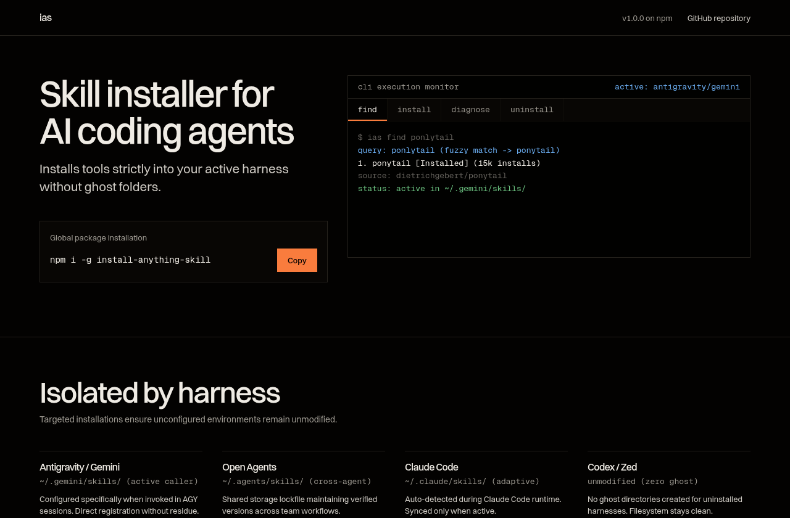

# enlighten-agent-tool

[](https://www.npmjs.com/package/enlighten-agent-tool)
[](https://opensource.org/licenses/MIT)
[](https://nodejs.org/)
[](https://github.com/Ayan-Jain-737/enlighten-agent-tool)

<div align="center">



</div>

## Universal GitHub Repository & Skill Installer for AI Agents

**Enlighten** is an autonomous skill and repository installer for AI agent harnesses. It installs in **one command**, automatically registers itself in the skills folder, and when an agent uses the skill to download/install any repository, it **automatically discovers and registers all skills in global skills folders** or executes whatever that repository suggests.

<div align="center">

| ✅ Feature | 🔧 Platform Support | 🌐 Languages & Managers |
|------------|---------------------|--------------------------|
| 1-Command Install | **Antigravity / Gemini** (`~/.gemini/skills/`) | npm, yarn, pnpm, bun |
| Auto Skill Registration | **Open Agents** (`~/.agents/skills/`) | pip, uv, poetry, pipenv |
| Auto-Synthesis for Tools | **Claude Code** (`~/.claude/skills/`) | cargo (Rust) |
| Multi-Harness Sync | **Hermes** (`~/.hermes/skills/`) | go build, go install |
| Binary Linking (`~/.local/bin`) | **OpenCode** (`~/.config/opencode/`) | gradle, maven |
| Safe Uninstall & Rollback | **Codex**, **Cursor**, **Zed** | cmake, make |

</div>

---

## 🚀 1-Command Installation

Anyone can install Enlighten in a single command using any of these methods:

### Method 1: Universal Shell One-Liner (Recommended)
```bash
curl -fsSL https://raw.githubusercontent.com/Ayan-Jain-737/enlighten-agent-tool/main/scripts/install.sh | bash
```

### Method 2: Open Agent Skills CLI
```bash
npx skills add Ayan-Jain-737/enlighten-agent-tool -g -y
```

### Method 3: NPM Global Install
```bash
npm install -g enlighten-agent-tool
```

### Method 4: From Local Clone
```bash
git clone https://github.com/Ayan-Jain-737/enlighten-agent-tool.git
cd enlighten-agent-tool
./scripts/install.sh
```

### What Happens on Installation:
- ✅ Links the `enlighten` executable directly to `~/.local/bin/enlighten` (in standard system PATH).
- ✅ Registers the `enlighten`, `enlighten-installer`, and `enlighten-uninstaller` skills into all agent skills directories (`~/.gemini/skills/`, `~/.agents/skills/`, `~/.claude/skills/`, `~/.hermes/skills/`, etc.).
- ✅ Installs slash command `/enlighten` in Claude Code and Hermes.
- ✅ Updates `~/.agents/.skill-lock.json`.

---

## ⚡ Quick Start

```bash
# Install any GitHub repository (skills are automatically registered globally!)
enlighten install vercel-labs/agent-skills

# Install by full URL
enlighten install https://github.com/affaan-m/ECC

# Preview installation without making changes (dry-run)
enlighten install https://github.com/user/repo --dry-run

# Output machine-readable JSON for agent consumption
enlighten install https://github.com/user/repo --json

# Diagnose repository before installing
enlighten diagnose https://github.com/user/repo

# List all managed repositories and registered skills
enlighten list-installed

# Safely remove a repository and unregister its skills
enlighten uninstall <identifier> --force
```

### Using Inside Agent Conversations
Any AI agent that has loaded the `enlighten` skill can run:
```bash
/enlighten install https://github.com/user/repo
```
or execute via the terminal tool:
```bash
enlighten install <repo-url>
```

---

## 🧠 How Auto-Registration Works

When an agent or developer runs `enlighten install <repo-url>`:

```
┌────────────────────────────────────────────────────────┐
│ 1. Clone / Fetch Repository                            │
│    Cloned into ~/.enlighten/repos/<owner>/<repo>       │
└──────────────────────────┬─────────────────────────────┘
                           │
┌──────────────────────────▼─────────────────────────────┐
│ 2. Deep Skill Discovery                                │
│    Finds SKILL.md at root, in skills/*, .agents/*      │
└──────────────────────────┬─────────────────────────────┘
                           │
             Skills found? │
            ┌──────────────┴──────────────┐
       YES  │                             │ NO
┌───────────▼──────────────────┐  ┌───────▼──────────────────────┐
│ Register Discovered Skills   │  │ Auto-Synthesize Skill        │
│ Link into ~/.gemini/skills/, │  │ Generate SKILL.md wrapper for│
│ ~/.agents/skills/, etc.      │  │ the newly installed tool     │
└───────────┬──────────────────┘  └───────┬──────────────────────┘
            └──────────────┬──────────────┘
                           │
┌──────────────────────────▼─────────────────────────────┐
│ 3. Execute "Whatever That Repo Suggests"                │
│    Runs npm install, pip install, cargo build, etc.    │
│    Symlinks executables to ~/.local/bin/               │
└──────────────────────────┬─────────────────────────────┘
                           │
┌──────────────────────────▼─────────────────────────────┐
│ 4. Update Registry & Lockfiles                         │
│    Recorded in ~/.enlighten/cache/installed.json       │
│    Recorded in ~/.agents/.skill-lock.json              │
└────────────────────────────────────────────────────────┘
```

---

## 📋 Commands

| Command | Description |
|---------|-------------|
| `enlighten install <url>` | Clone repo, register skills globally, run suggested build steps |
| `enlighten diagnose <url>` | Analyze repository without installing (languages, frameworks, skills) |
| `enlighten list-installed` | Show all managed installations and their registered skills |
| `enlighten uninstall <id> --force` | Safe removal of repository, binaries, and registered skills |
| `enlighten --help` | Show command line help and options |

---

## 🌐 Supported Platforms & Global Skill Locations

| Agent Framework | Global Skills Directory | Slash Commands |
|-----------------|-------------------------|----------------|
| **Antigravity / Gemini** | `~/.gemini/skills/` | Automatic skill progressive disclosure |
| **Open Agents** | `~/.agents/skills/` & `.skill-lock.json` | `npx skills` compatible |
| **Claude Code** | `~/.claude/skills/` | `~/.claude/commands/enlighten.md` (`/enlighten`) |
| **Hermes** | `~/.hermes/skills/` | `~/.hermes/commands/enlighten.md` (`/enlighten`) |
| **OpenCode** | `~/.config/opencode/skills/` | Config plugin / skill directory |
| **Codex** | `~/.codex/skills/` | Global skills directory |
| **Cursor** | `~/.cursor/skills/` | Workspace and global skills |
| **Zed** | `~/.zed/skills/` | Global skills |

---

## 🏗️ Architecture

```
enlighten-agent-tool/
├── bin/
│   └── enlighten                    # CLI executable (full lifecycle engine)
├── skills/
│   ├── enlighten/                   # Primary agent skill definition
│   │   ├── SKILL.md
│   │   └── scripts/dispatch.js      # Resilient CLI dispatcher
│   ├── enlighten-installer/         # Scanner, adapter & skill registry engine
│   │   ├── SKILL.md
│   │   └── scripts/
│   │       ├── scan-repo.js         # Deep repo & skill scanner
│   │       ├── skill-registry.js    # Multi-harness registration manager
│   │       └── adapt-install.js     # OS & harness command adapter
│   └── enlighten-uninstaller/       # Safe removal skill
│       └── SKILL.md
├── commands/
│   └── enlighten.md                 # Agent slash command definition
├── scripts/
│   ├── install.sh                   # Universal 1-command curl installer
│   ├── install.js                   # Node.js self-registration script
│   └── postinstall.js               # NPM postinstall hook
├── tests/
│   ├── test-scanner.js              # Scanner unit tests
│   ├── test-skills.js               # Multi-harness skill registration tests
│   └── test-lifecycle.js            # End-to-end install/uninstall lifecycle tests
├── package.json
└── README.md
```

---

## 🧪 Testing

Run the full test suite with:

```bash
npm test
```

Includes:
- Scanner tests for language, framework, dependencies, and skills.
- Skill discovery and multi-harness global registration tests.
- Full CLI lifecycle tests (`diagnose` -> `install` -> `list-installed` -> `uninstall`).

---

## 📄 License

MIT © Ayan Jain
